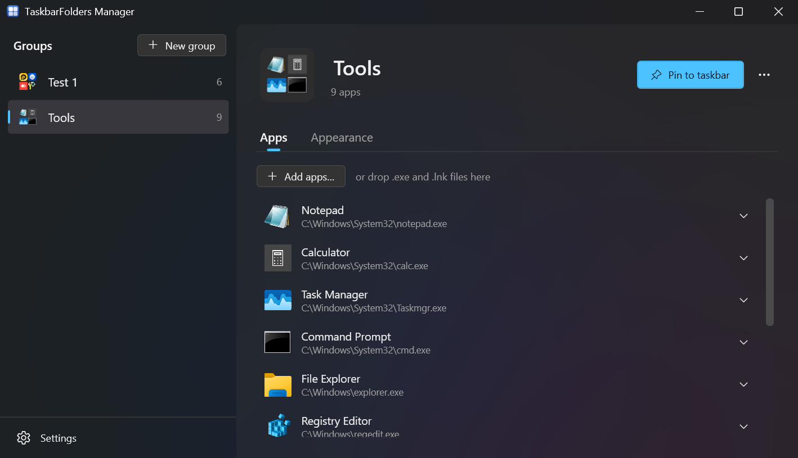
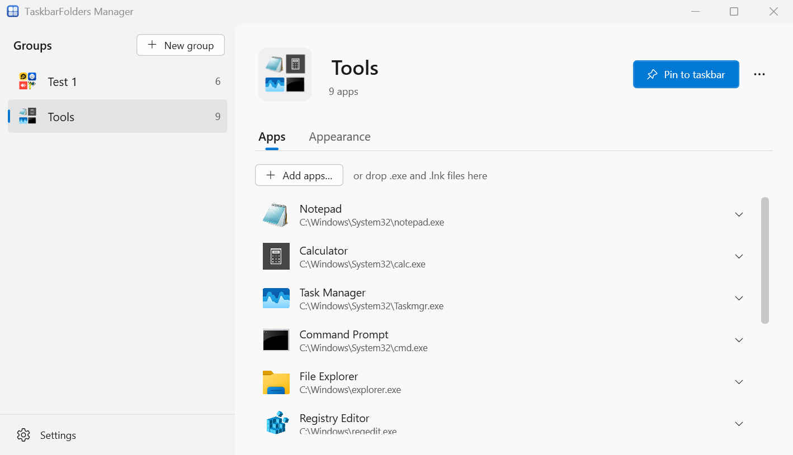
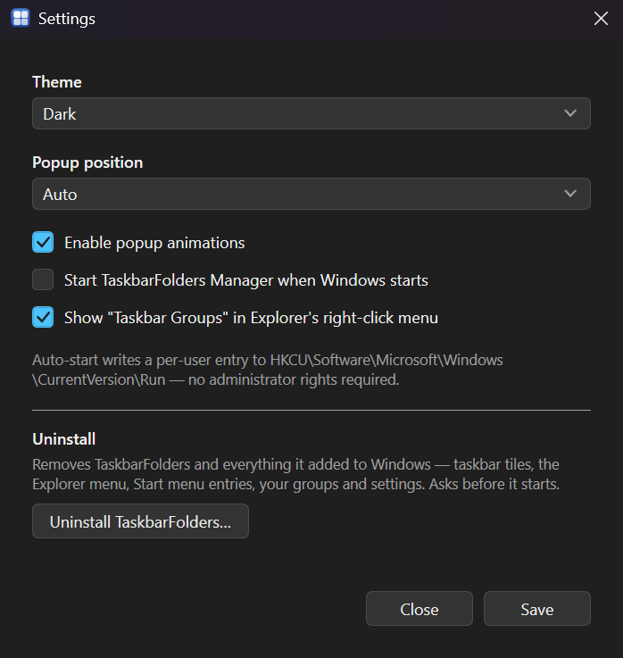
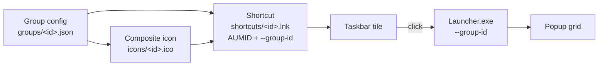
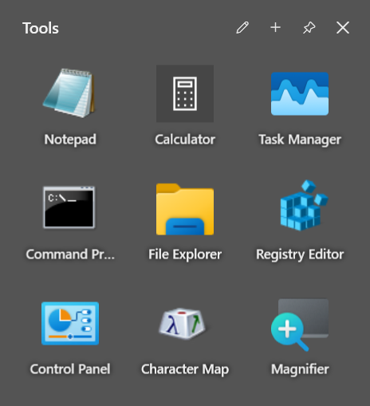

<a id="readme-top"></a>

<!-- PROJECT SHIELDS -->
[![CI][ci-shield]][ci-url]
[![Release][release-shield]][release-url]
[![Issues][issues-shield]][issues-url]
[![MIT License][license-shield]][license-url]


<p align="center">
  <b>English</b> · <a href="README.tr.md">Türkçe</a>
</p>

<!-- PROJECT LOGO -->
<br />
<div align="center">
  <h3 align="center">Taskbar Folders</h3>

  <p align="center">
    macOS-style app folders for the Windows 11 taskbar.
    <br />
    Group related apps behind a single pinned tile; click it and they fan out in a popup anchored to the tile.
    <br />
    <br />
    <a href="https://github.com/aybrkaknc/TaskbarFolders/releases"><strong>Download the latest release »</strong></a>
    <br />
    <br />
    <a href="docs/user-guide.md">User Guide</a>
    &middot;
    <a href="docs/troubleshooting.md">Troubleshooting</a>
    &middot;
    <a href="https://github.com/aybrkaknc/TaskbarFolders/issues/new?labels=bug">Report Bug</a>
    &middot;
    <a href="https://github.com/aybrkaknc/TaskbarFolders/issues/new?labels=enhancement">Request Feature</a>
  </p>
</div>


<!-- TABLE OF CONTENTS -->
<details>
  <summary>Table of Contents</summary>
  <ol>
    <li>
      <a href="#about-the-project">About The Project</a>
      <ul>
        <li><a href="#built-with">Built With</a></li>
      </ul>
    </li>
    <li>
      <a href="#getting-started">Getting Started</a>
      <ul>
        <li><a href="#requirements">Requirements</a></li>
        <li><a href="#installation">Installation</a></li>
        <li><a href="#building-from-source">Building from source</a></li>
      </ul>
    </li>
    <li>
      <a href="#usage">Usage</a>
      <ul>
        <li><a href="#quick-start">Quick start</a></li>
        <li><a href="#settings">Settings</a></li>
        <li><a href="#how-it-works">How it works</a></li>
        <li><a href="#where-your-data-lives">Where your data lives</a></li>
      </ul>
    </li>
    <li><a href="#troubleshooting">Troubleshooting</a></li>
    <li><a href="#project-structure">Project structure</a></li>
    <li><a href="#roadmap">Roadmap</a></li>
    <li><a href="#contributing">Contributing</a></li>
    <li><a href="#license">License</a></li>
    <li><a href="#contact">Contact</a></li>
    <li><a href="#acknowledgments">Acknowledgments</a></li>
  </ol>
</details>


<!-- ABOUT THE PROJECT -->
## About The Project

<p align="center">
  
</p>

Taskbar Folders lets you put related Windows apps into a **group**, pin that group to the taskbar as one tile, and open the group's apps from a popup that appears next to the tile.

* **Groups of apps behind one taskbar tile.** Drag `.exe` or `.lnk` files into a group; the group gets its own pinnable shortcut.
* **Composite group icons.** Each group's icon is generated from the icons of the apps inside it — one centred, two side by side, three in an iOS-style arrangement, four or more as a 2×2 of the first four.
* **One-click pinning.** The Manager asks Windows to pin the group for you. Windows shows its own confirmation dialog; if your edition or policy blocks programmatic pinning, the Manager opens the shortcut folder so you can pin it by hand.
* **A popup that looks like Windows.** Clicking a pinned group opens a popup on Mica, the material of Windows' own apps — or Mica Alt, Acrylic or a plain panel, with an optional colour tint, per group or for all. It closes when it loses focus or after you launch something, unless you keep it open.
* **Follows your Windows theme.** Light, dark, or system; the system option switches live when Windows does.
* **Multi-monitor and high-DPI aware.** The popup anchors to the monitor under the cursor and places correctly at 100–200 % display scaling.

<table>
  <tr>
    <td align="center"><br><sub>Dark</sub></td>
    <td align="center"><br><sub>Light</sub></td>
  </tr>
</table>

Taskbar Folders is **not** a taskbar replacement or shell extension — it adds pinned shortcuts and does not hook Explorer. It is also not a launcher with search, hotkeys or recents: the popup is a grid of the apps you put in the group, nothing more.

<p align="right">(<a href="#readme-top">back to top</a>)</p>


### Built With

* [![.NET][.NET-shield]][.NET-url]
* [![WPF][WPF-shield]][WPF-url]
* [![Inno Setup][InnoSetup-shield]][InnoSetup-url]

Built on .NET 8 and WPF with MVVM through CommunityToolkit.Mvvm, Win32/COM interop for shell integration, and Inno Setup for the installer. Full list in [Project structure](#project-structure).

<p align="right">(<a href="#readme-top">back to top</a>)</p>


<!-- GETTING STARTED -->
## Getting Started

### Requirements

| | |
|---|---|
| **OS** | Windows 11 recommended. The installer permits Windows 10 1809 and later. |
| **.NET runtime** | Not required — releases are self-contained. |
| **Architecture** | x64. There is no ARM64 build. |

Two features degrade gracefully on older builds rather than failing:

- **One-click pinning** needs `Windows.UI.Shell.TaskbarManager` (Windows 10 2004 / build 19041 and later) and an edition that permits programmatic pinning. Where it is unavailable the Manager falls back to opening the shortcut folder for a manual pin.
- **The Mica backdrop** on the Manager window needs Windows 11 22H2 or later. Older builds get solid backgrounds.

<p align="right">(<a href="#readme-top">back to top</a>)</p>

### Installation

#### Installer

1. Download `TaskbarFolders-Setup.exe` from [Releases](https://github.com/gianluca-schwekendiek/taskbar-grouping/releases).
2. Run it. It installs for your user account into `%LOCALAPPDATA%\Programs\TaskbarFolders`, needs no administrator rights, and offers to start Taskbar Folders with Windows (this option is pre-selected).
3. Launch **TaskbarFolders Manager** from the Start menu.

#### Portable

1. Download `TaskbarFolders-portable.zip` from [Releases](https://github.com/gianluca-schwekendiek/taskbar-grouping/releases).
2. Extract it anywhere. Keep the `Manager` and `Launcher` folders side by side — the Manager locates the launcher relative to itself.
3. Run `Manager\TaskbarFolders.Manager.exe`.

<p align="right">(<a href="#readme-top">back to top</a>)</p>

### Building from source

Requires the [.NET 8 SDK](https://dotnet.microsoft.com/download/dotnet/8.0) (pinned to 8.0.100 in `global.json`, rolling forward to a newer major) on Windows.

```bash
git clone https://github.com/gianluca-schwekendiek/taskbar-grouping.git
cd taskbar-grouping
dotnet build TaskbarFolders.sln -c Release
```

```bash
dotnet test TaskbarFolders.sln -c Release
```

```bash
dotnet format TaskbarFolders.sln --verify-no-changes
```

The format check is a hard CI gate — run it before pushing. Tests need the `Microsoft.WindowsDesktop.App 8.0.x` runtime; if the machine only has a newer major, prefix with `DOTNET_ROLL_FORWARD=LatestMajor`. See [docs/developer-guide.md](docs/developer-guide.md) for the full setup, the analyzer rules the build enforces, and how to run the launcher directly.

<p align="right">(<a href="#readme-top">back to top</a>)</p>


<!-- USAGE EXAMPLES -->
## Usage

### Quick start

1. Open **TaskbarFolders Manager**.
2. Click **+ New group**, type a name over *New group* and press `Enter`.
3. Drop `.exe` or `.lnk` files onto the **Apps** tab, or use **Add apps…**. The group's icon at the top updates as you go.
4. Click **Pin to taskbar**. Windows asks you to confirm — that prompt comes from Windows and cannot be skipped.
5. Click the new taskbar tile. The popup opens; click any icon to launch it.

If step 4 reports that pinning is unavailable, the Manager opens the shortcut folder for you. Right-click the `.lnk` there → **Show more options** (on Windows 11 22H2+) → **Pin to taskbar**. The same folder is reachable any time via **⋯ → Show shortcut…**.

A group with no apps in it produces no icon and no shortcut, so add at least one app before pinning.

<p align="right">(<a href="#usage">back to top</a>)</p>

### Settings

Open with **Settings** at the bottom of the group list. Each setting applies and is stored as soon as you change it.

| Setting | Options | Default |
|---|---|---|
| Theme | System, Light, Dark | System |
| Popup position | Auto, Above, Below | Auto |
| Popup backdrop | Mica, Mica Alt, Acrylic, Off | Mica |
| Popup tint | None, Accent, Midnight, Forest, Sunset | None |
| Enable popup animations | on / off | on |
| Start TaskbarFolders Manager when Windows starts | on / off | off |
| Show "Taskbar Groups" in Explorer's right-click menu | on / off | on |

<p align="center">
  
</p>

Autostart is a per-user `HKCU\…\CurrentVersion\Run` entry — no scheduled task, no service. The registry is read as the source of truth, so removing that entry by hand is respected.

<p align="right">(<a href="#usage">back to top</a>)</p>

### How it works

Every group gets its own `.lnk` in `%APPDATA%\TaskbarFolders\shortcuts\`. The shortcut points at the **one shared** `TaskbarFolders.Launcher.exe`, passes `--group-id`, uses the group's generated `.ico`, and carries a distinct AppUserModelID (`TaskbarFolders.Group.<id>`) stamped through `IPropertyStore`. Windows treats each AppUserModelID as a separate application, which is what makes the groups sit next to each other on the taskbar as independent tiles.

A matching shortcut is also written into the Start menu. That copy is not cosmetic: Windows only persists a programmatic pin if the AppUserModelID is already known to the Start menu index.



<p align="center">
  
</p>

Full detail in [docs/architecture.md](docs/architecture.md), and the reasoning behind the shared-launcher design in [ADR-002](docs/adr/002-per-group-lnk-aumid.md).

<p align="right">(<a href="#usage">back to top</a>)</p>

### Where your data lives

Everything is under `%APPDATA%\TaskbarFolders\`:

| Path | Contents |
|---|---|
| `groups\<id>.json` | One file per group. The file name is the group id; the `id` field inside is ignored on load. |
| `icons\<id>.ico` | Generated composite icon, 16/32/48/256 px. |
| `icons\cache\<hash>.png` | Extracted source icons, keyed by path, write time and size. Pruned after 30 days. |
| `shortcuts\<id>.lnk` | The pinnable shortcut. |
| `settings.json` | Global settings. |
| `logs\manager-*.log`, `logs\launcher-*.log` | One file per day, kept 14 days. |

Each group's popup layout — columns (1–6), icon size, and whether names are shown — is set on the Manager's *Appearance* tab.

Uninstalling — through *Installed apps* or *Settings → Uninstall TaskbarFolders…* — deletes this folder too, along with the group tiles, the Explorer menu entry, the Start menu entries and the autostart entry. Back up `groups\` first if you want to keep your groups.

<p align="right">(<a href="#usage">back to top</a>)</p>


<!-- TROUBLESHOOTING -->
## Troubleshooting

Start with the logs in `%APPDATA%\TaskbarFolders\logs\`; the launcher records every failure path there, including the exit code. [docs/troubleshooting.md](docs/troubleshooting.md) maps the common symptoms — a tile that does nothing, a pin that produces no tile, a popup in the wrong place at scaled resolutions — to their causes and fixes, and lists the current known limitations.

<p align="right">(<a href="#readme-top">back to top</a>)</p>


<!-- PROJECT STRUCTURE -->
## Project structure

```
TaskbarFolders/
├── src/
│   ├── TaskbarFolders.Shared/      # Models, JSON persistence, file logging
│   ├── TaskbarFolders.Core/        # Icon engine, Win32/COM interop, shortcut generation
│   ├── TaskbarFolders.Manager/     # WPF app for creating and managing groups
│   └── TaskbarFolders.Launcher/    # Per-group popup, invoked by the pinned shortcut
├── tests/                          # xUnit test projects, one per source project
├── docs/                           # Guides and architecture decision records
├── installer/                      # Inno Setup script
└── assets/                         # Application icons and screenshots
```

| Component | Technology |
|---|---|
| Language / runtime | C# 12, .NET 8 |
| UI | WPF, MVVM via CommunityToolkit.Mvvm |
| DI | Microsoft.Extensions.DependencyInjection |
| Shell integration | Win32 P/Invoke + COM (`IShellLinkW`, `IPropertyStore`, `IImageList`), WinRT `TaskbarManager` |
| Tests | xUnit, Moq, FluentAssertions |
| Packaging | Inno Setup, self-contained `win-x64` publish |
| CI/CD | GitHub Actions |

Documentation:

- [User Guide](docs/user-guide.md) — everything the app can do, from a user's point of view
- [Benutzerhandbuch](docs/benutzerhandbuch.md) — the same guide in German
- [Troubleshooting](docs/troubleshooting.md) — symptoms, causes, known limitations
- [Architecture](docs/architecture.md) — components, data flow, runtime layout
- [Developer Guide](docs/developer-guide.md) — build, test, debug, conventions
- [API Reference](docs/api-reference.md) — the public surface of the libraries
- [Release Process](docs/release-process.md) — version bumps, tagging, verification
- [Architecture Decision Records](docs/adr/README.md) — why things are the way they are

<p align="right">(<a href="#readme-top">back to top</a>)</p>


<!-- ROADMAP -->
## Roadmap

- [x] Groups with composite icons and one-click pinning
- [x] Popup with Mica, Acrylic and tint options, following the Windows theme
- [x] Per-group popup layout (columns, icon size, names)
- [x] Installer and portable release, with an uninstaller that leaves nothing behind
- [ ] Work in progress on the fork's `feature/send-to-group` branch (see [Acknowledgments](#acknowledgments))

See [plan.md](plan.md) for the full roadmap and [CHANGELOG.md](CHANGELOG.md) for what has shipped.

<p align="right">(<a href="#readme-top">back to top</a>)</p>


<!-- CONTRIBUTING -->
## Contributing

Contributions are what make the open source community such an amazing place to learn, inspire, and create. Any contributions you make are **greatly appreciated**.

See [CONTRIBUTING.md](CONTRIBUTING.md) for the branching model, commit conventions and the checks that must pass. Bug reports and feature requests go through the [issue templates](.github/ISSUE_TEMPLATE); [SUPPORT.md](SUPPORT.md) explains where to ask questions, and [SECURITY.md](SECURITY.md) covers vulnerability reporting.

1. Fork the Project
2. Create your Feature Branch (`git checkout -b feature/AmazingFeature`)
3. Commit your Changes (`git commit -m 'feat(scope): add some AmazingFeature'`)
4. Push to the Branch (`git push origin feature/AmazingFeature`)
5. Open a Pull Request

<p align="right">(<a href="#readme-top">back to top</a>)</p>


<!-- LICENSE -->
## License

Distributed under the MIT License. See [LICENSE](LICENSE) for more information. Third-party components are listed in [THIRD-PARTY-NOTICES.md](THIRD-PARTY-NOTICES.md).

<p align="right">(<a href="#readme-top">back to top</a>)</p>


<!-- CONTACT -->
## Contact

Project Link: [https://github.com/aybrkaknc/TaskbarFolders](https://github.com/aybrkaknc/TaskbarFolders)

For bugs and feature requests, open an [issue](https://github.com/aybrkaknc/TaskbarFolders/issues). For security reports, use GitHub's private vulnerability reporting as described in [SECURITY.md](SECURITY.md).

<p align="right">(<a href="#readme-top">back to top</a>)</p>


<!-- ACKNOWLEDGMENTS -->
## Acknowledgments

* [Gian Luca Schwekendiek](https://github.com/gianluca-schwekendiek) — the upstream [taskbar-grouping](https://github.com/gianluca-schwekendiek/taskbar-grouping) project this fork is based on (MIT, © 2026 Gian Luca Schwekendiek). The upstream copyright notice is kept in [LICENSE](LICENSE).
* This fork is developed independently. Work in progress lives on the [`feature/send-to-group`](https://github.com/aybrkaknc/TaskbarFolders/tree/feature/send-to-group) branch and is not released yet; releases and downloads are still the upstream project's.
* [Best-README-Template](https://github.com/othneildrew/Best-README-Template) — the README structure used here (Unlicense).
* [Img Shields](https://shields.io) — the badges.

<p align="right">(<a href="#readme-top">back to top</a>)</p>


<!-- MARKDOWN LINKS & IMAGES -->
<!-- https://www.markdownguide.org/basic-syntax/#reference-style-links -->
[ci-shield]: https://github.com/aybrkaknc/TaskbarFolders/actions/workflows/ci.yml/badge.svg
[ci-url]: https://github.com/aybrkaknc/TaskbarFolders/actions/workflows/ci.yml
[release-shield]: https://github.com/gianluca-schwekendiek/taskbar-grouping/actions/workflows/release.yml/badge.svg
[release-url]: https://github.com/gianluca-schwekendiek/taskbar-grouping/releases
[issues-shield]: https://img.shields.io/github/issues/aybrkaknc/TaskbarFolders.svg?style=for-the-badge
[issues-url]: https://github.com/aybrkaknc/TaskbarFolders/issues
[license-shield]: https://img.shields.io/github/license/aybrkaknc/TaskbarFolders.svg?style=for-the-badge
[license-url]: https://github.com/aybrkaknc/TaskbarFolders/blob/develop/LICENSE
[.NET-shield]: https://img.shields.io/badge/.NET_8-512BD4?style=for-the-badge&logo=dotnet&logoColor=white
[.NET-url]: https://dotnet.microsoft.com/
[WPF-shield]: https://img.shields.io/badge/WPF-0C54C2?style=for-the-badge&logo=windows&logoColor=white
[WPF-url]: https://learn.microsoft.com/dotnet/desktop/wpf/
[InnoSetup-shield]: https://img.shields.io/badge/Inno_Setup-1F6FEB?style=for-the-badge
[InnoSetup-url]: https://jrsoftware.org/isinfo.php
