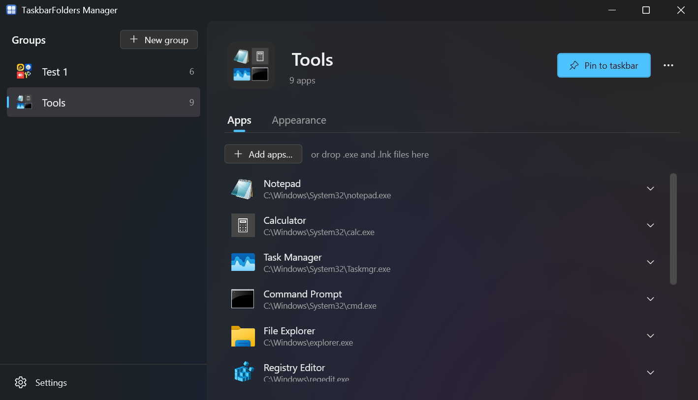
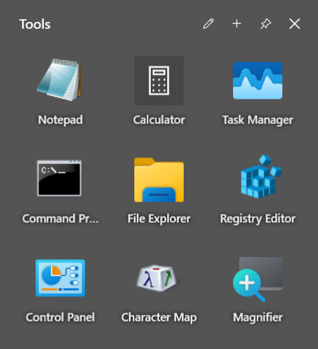
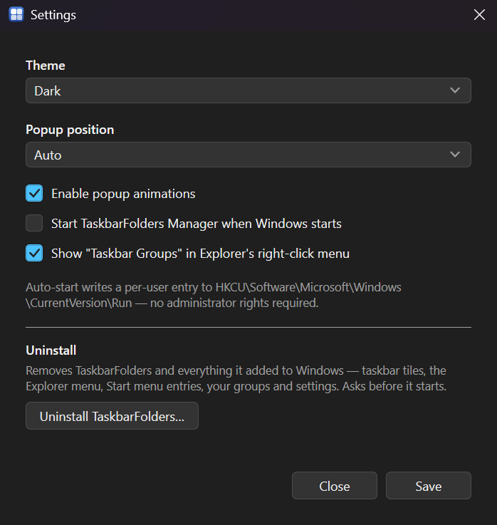

# TaskbarFolders — Benutzerhandbuch

Dieses Handbuch erklärt TaskbarFolders aus Anwendersicht: was das Programm tut, wie Sie es einrichten und was Sie tun können, wenn etwas nicht funktioniert. Vorkenntnisse werden nicht vorausgesetzt.

> Englischsprachige Fassung: [User Guide](user-guide.md). Beide Dokumente beschreiben denselben Stand und werden gemeinsam gepflegt.

## Inhalt

- [Was TaskbarFolders macht](#was-taskbarfolders-macht)
- [Systemvoraussetzungen](#systemvoraussetzungen)
- [Installation](#installation)
- [Schnelleinstieg](#schnelleinstieg)
- [Gruppen anlegen und füllen](#gruppen-anlegen-und-füllen)
- [Das Gruppensymbol](#das-gruppensymbol)
- [An die Taskleiste anheften](#an-die-taskleiste-anheften)
- [Eine Gruppe benutzen](#eine-gruppe-benutzen)
- [Gruppen ändern und löschen](#gruppen-ändern-und-löschen)
- [Einstellungen](#einstellungen)
- [Wo Ihre Daten liegen](#wo-ihre-daten-liegen)
- [Wenn etwas nicht funktioniert](#wenn-etwas-nicht-funktioniert)
- [Was derzeit nicht geht](#was-derzeit-nicht-geht)
- [Deinstallieren](#deinstallieren)

## Was TaskbarFolders macht

TaskbarFolders fasst mehrere Programme zu einer **Gruppe** zusammen und legt für diese Gruppe eine einzelne Kachel in der Windows-Taskleiste an. Ein Klick auf die Kachel klappt die enthaltenen Programme in einem kleinen Fenster auf — vergleichbar mit einem App-Ordner auf dem iPhone-Homescreen.

Der Nutzen: statt acht angehefteter Symbole für Entwicklungswerkzeuge belegt eine Gruppe „Dev Tools" einen Platz, und die acht Programme sind trotzdem mit zwei Klicks erreichbar.

Das Programm besteht aus zwei Teilen:

| Teil | Wofür |
|---|---|
| **TaskbarFolders Manager** | Das Fenster, in dem Sie Gruppen anlegen, Programme hinzufügen und Einstellungen ändern. Das benutzen Sie bewusst. |
| **TaskbarFolders Launcher** | Das kleine Aufklapp-Fenster. Es startet automatisch, wenn Sie auf eine Gruppenkachel klicken, und schließt sich von selbst wieder. |

**Was TaskbarFolders nicht ist:** kein Ersatz für die Taskleiste und kein Eingriff in den Windows-Explorer. Es legt gewöhnliche Verknüpfungen an, mehr nicht. Es ist auch kein Startmenü-Ersatz mit Suche oder Tastenkürzeln — das Aufklapp-Fenster zeigt genau die Programme, die Sie in die Gruppe gelegt haben.

## Systemvoraussetzungen

| | |
|---|---|
| **Betriebssystem** | Windows 11 empfohlen. Der Installer lässt Windows 10 ab Version 1809 zu. |
| **.NET** | Nichts zu installieren. Alles Nötige ist im Programm enthalten. |
| **Architektur** | 64 Bit (x64). Für ARM64 gibt es keine Fassung. |

Zwei Funktionen richten sich nach Ihrer Windows-Version, fallen aber nicht aus, sondern weichen aus:

- **Anheften per Knopfdruck** braucht Windows 10 Version 2004 oder neuer. Wo es nicht verfügbar ist — auch in verwalteten Firmenumgebungen — öffnet TaskbarFolders den Ordner mit der Verknüpfung, damit Sie von Hand anheften können.
- **Der Mica-Hintergrund** des Manager-Fensters braucht Windows 11 22H2 oder neuer. Ältere Versionen zeigen eine schlichte Farbfläche.

## Installation

### Mit Installationsprogramm

1. Laden Sie `TaskbarFolders-Setup.exe` von der [Releases-Seite](https://github.com/gianluca-schwekendiek/taskbar-grouping/releases) herunter.
2. Starten Sie die Datei. Das Programm wird nur für Ihr Benutzerkonto nach `%LOCALAPPDATA%\Programs\TaskbarFolders` installiert; Administratorrechte sind nicht nötig.
3. Im Assistenten können Sie zwei Dinge wählen:
   - **Mit Windows starten** — ist vorausgewählt. Der Manager startet dann bei jeder Anmeldung mit. Sie können das später in den Einstellungen ändern.
   - **Desktopsymbol anlegen** — ist nicht vorausgewählt.
4. Starten Sie **TaskbarFolders Manager** über das Startmenü.

Eine neue Version installieren Sie einfach über die alte. Der Installer erkennt die vorhandene Installation, ersetzt sie und lässt Ihre Gruppen unangetastet. Schließen Sie vorher den Manager.

### Portable Fassung

1. Laden Sie `TaskbarFolders-portable.zip` herunter und entpacken Sie es an einen beliebigen Ort.
2. Starten Sie `Manager\TaskbarFolders.Manager.exe`.

**Wichtig:** Die beiden Ordner `Manager` und `Launcher` müssen nebeneinander liegen bleiben. Der Manager sucht den Launcher relativ zu sich selbst — trennen Sie die Ordner, lassen sich keine Gruppen mehr erzeugen.

## Schnelleinstieg

1. **TaskbarFolders Manager** öffnen. Der Schreibcursor steht bereits im Namensfeld.
2. Einen Namen tippen, zum Beispiel `Dev Tools`, und auf **+ Add** klicken oder `Enter` drücken.
3. Programme in die Liste ziehen oder über **Add app…** auswählen.
4. Auf **Pin to taskbar** klicken und die Rückfrage von Windows bestätigen.
5. Auf die neue Kachel in der Taskleiste klicken — das Aufklapp-Fenster erscheint.

## Gruppen anlegen und füllen

### Gruppe anlegen

Klicken Sie oben in der Liste links auf **+ New group**. Es erscheint eine Gruppe namens *New group*, bereits ausgewählt, und ihr Name oben im rechten Bereich ist markiert — tippen Sie einfach den gewünschten Namen und drücken Sie `Enter`. (Eine zweite heißt *New group 2* und so weiter.)

In der Liste links stehen alle Gruppen alphabetisch. Jede Zeile zeigt das Symbol der Gruppe, wie es in der Taskleiste erscheint — einen Ordnerumriss, solange die Gruppe leer ist —, und rechts die Anzahl der enthaltenen Programme.

### Programme hinzufügen

Wählen Sie eine Gruppe aus. Dann auf der Registerkarte **Apps** entweder

- Dateien mit der Maus aus dem Explorer irgendwo auf die Registerkarte **ziehen** — sie wird dabei umrandet —, oder
- auf **Add apps…** klicken und eine oder mehrere Dateien auswählen.

Es werden nur Programmdateien (`.exe`) und Verknüpfungen (`.lnk`) übernommen. Ziehen Sie versehentlich anderes mit, wird es kommentarlos übergangen.

Der angezeigte Name stammt aus dem Dateinamen, das Symbol aus der Datei selbst — bei einer Verknüpfung aus dem Programm, auf das sie zeigt. Ein Programm ohne eigenes Symbol — oder dessen Datei nicht mehr auffindbar ist — erscheint stattdessen als schlichter Fensterumriss, in der Liste, im Aufklapp-Fenster und im Symbol der Gruppe.

Der Pfad unter dem Namen wird gekürzt dargestellt: alles innerhalb Ihres Benutzerordners erscheint als `%USERPROFILE%\…`, damit Ihr Kontoname nicht in Screenshots oder bei Bildschirmfreigaben zu sehen ist. Fahren Sie mit der Maus über den Pfad, um ihn vollständig zu sehen. Gespeichert und gestartet wird immer der echte Pfad.

### Name, Startparameter und Symbol eines Programms

Ein Klick auf ein Programm in der Liste öffnet unter der Zeile seine Einstellungen:

- **Name** — die Beschriftung seiner Kachel im Aufklapp-Fenster. Leer gelassen, gilt wieder der Dateiname.
- **Arguments** — Startparameter, die das Programm beim Start erhält, zum Beispiel `--profile-directory="Profile 2"`, um einen Browser mit einem zweiten Profil zu öffnen. Leer bedeutet: keine.
- **Icon** — **Change icon…** wählt ein `.ico`, `.png`, `.jpg` oder `.bmp`, das statt des Programmsymbols erscheint: im Aufklapp-Fenster, in dieser Liste und im Gruppensymbol. **Use program icon** kehrt zum Programmsymbol zurück. Gespeichert wird eine Kopie; das Original darf verschoben oder gelöscht werden.

Name und Startparameter werden gespeichert, sobald Sie das Feld verlassen oder `Enter` drücken; `Esc` stellt den gespeicherten Wert wieder her. Ein neues Symbol wird sofort gespeichert und das Gruppensymbol neu erzeugt.

### Programm entfernen

Zeigen Sie mit der Maus auf die Zeile (oder wählen Sie sie aus) und klicken Sie rechts auf das Papierkorb-Symbol, oder wählen Sie sie aus und drücken Sie `Entf`. Entfernt wird nur der Eintrag in der Gruppe — das Programm selbst bleibt unberührt. Die Gruppe wird sofort gespeichert und ihr Symbol neu erzeugt.

## Das Gruppensymbol

Das Symbol der Gruppe wird aus den Symbolen der enthaltenen Programme zusammengesetzt. Es verwendet die **ersten vier** Programme der Gruppe — im Aufklapp-Fenster erscheinen später trotzdem alle.

| Programme | Anordnung |
|---|---|
| 1 | Ein Symbol, mittig |
| 2 | Zwei nebeneinander |
| 3 | Zwei oben, eines unten |
| 4 oder mehr | Die ersten vier als 2×2-Raster |

### Ein eigenes Bild als Symbol

Ein Klick auf das Gruppensymbol oben im rechten Bereich → **Change icon…** (oder **Choose image…** auf der Registerkarte **Appearance**) öffnet die Dateiauswahl für ein `.ico`, `.png`, `.jpg` oder `.bmp`. Das Gruppensymbol — Verknüpfung, Startmenü-Eintrag und angeheftete Kachel — zeigt dann dieses Bild statt der Programme, ganz gleich, welche Programme Sie hinzufügen oder entfernen. Gespeichert wird eine Kopie, quadratisch eingepasst mit durchsichtigen Rändern; die Originaldatei darf also verschoben oder gelöscht werden. Bei einer `.ico`-Datei wird die größte enthaltene Größe verwendet.

**Use app icons** im selben Menü kehrt zum aus den Programmen zusammengesetzten Symbol zurück. Zeigt eine angeheftete Kachel noch das alte Bild, hat Windows ihr Symbol noch nicht neu gelesen; Ab- und wieder Anmelden oder ein Neustart des Explorers hilft.

Das Symbol oben links im rechten Bereich aktualisiert sich kurz nachdem Sie mit dem Ändern fertig sind.

## An die Taskleiste anheften

Eine Gruppe muss mindestens ein Programm enthalten. Eine leere Gruppe erzeugt weder Symbol noch Verknüpfung und lässt sich deshalb nicht anheften.

### Der direkte Weg

Klicken Sie auf **Pin to taskbar**. Windows zeigt daraufhin eine eigene Rückfrage, ob das Anheften erlaubt ist. Bestätigen Sie sie, erscheint die Kachel.

Diese Rückfrage kommt von Windows und lässt sich weder überspringen noch automatisieren. Wenn Sie sie abbrechen, wird nichts angeheftet.

Anschließend prüft der Manager nach, ob tatsächlich eine Kachel entstanden ist, statt sich auf die Rückmeldung von Windows zu verlassen. Sollte der Pin gemeldet werden, ohne dass etwas erscheint, erhalten Sie die Meldung **Pin not confirmed** und der Verknüpfungsordner öffnet sich zum Anheften von Hand. Ihnen wird also nie „angeheftet" gemeldet, wenn nichts angeheftet wurde.

### Wenn der direkte Weg nicht verfügbar ist

Manche Windows-Editionen und viele Firmenrechner verbieten das Anheften durch Programme. In dem Fall sagt der Manager Bescheid und öffnet den Ordner mit der Verknüpfung.

Dort klicken Sie mit der rechten Maustaste auf die `.lnk`-Datei → **Weitere Optionen anzeigen** (unter Windows 11 22H2 und neuer) → **An Taskleiste anheften**.

Diesen Ordner erreichen Sie jederzeit über **⋯ → Show shortcut…** neben **Pin to taskbar**.

## Eine Gruppe benutzen

Klicken Sie auf die angeheftete Kachel. Neben der Taskleiste öffnet sich ein Fenster mit allen Programmen der Gruppe. Unter Windows 11 22H2 und neuer liegt es auf einer leicht verschwommenen, durchscheinenden Glasfläche im Farbton Ihres Erscheinungsbilds, wie die Menüs von Windows selbst. Ältere Versionen zeigen eine schlichte durchscheinende Fläche.

- Oben im Fenster steht der Name der Gruppe.
- **Auf ein Symbol klicken** startet das Programm, das Fenster schließt sich.
- **Auf ✕** oben rechts klicken schließt das Fenster, ohne etwas zu starten.
- **Auf +** klicken fügt Programme hinzu: Es öffnet sich eine Dateiauswahl, und jede gewählte .exe- oder .lnk-Datei kommt in die Gruppe und erscheint sofort im Fenster. Taskleistensymbol und Verknüpfung werden wie aus dem Manager aktualisiert. Solange die Auswahl offen ist, bleibt das Fenster stehen.
- **Auf ✎** klicken, um Programme zu entfernen: Jede Kachel bekommt ein kleines ✕, ein Klick darauf nimmt das Programm aus der Gruppe — nur aus der Gruppe; die Programmdatei oder Verknüpfung bleibt unberührt. Während der Bearbeitung starten die Kacheln nichts. Mit ✓ (oder `Esc`) beenden. Wird das letzte Programm entfernt, ist die Gruppe leer und lässt sich mit + wieder füllen.
- **Lässt sich ein Programm nicht starten**, bleibt das Fenster offen und zeigt einen roten Hinweis mit dem Namen.
- **Auf die Stecknadel** klicken hält das Fenster offen: Solange sie hervorgehoben ist, schließen weder ein Klick daneben noch ein Fensterwechsel noch das Starten eines Programms das Fenster — so lassen sich mehrere Programme nacheinander starten. ✕, **`Esc`** oder ein Klick auf die Taskleistenkachel der Gruppe schließen es weiterhin; das nächste Fenster öffnet sich ohne Nadel.
- **Klick daneben** oder **`Esc`** schließt das Fenster. Der Klick daneben wirkt auch dann, wenn Windows dem Fenster den Fokus nicht gegeben hat.
- **Erneuter Klick auf die Taskleistenkachel** der Gruppe schließt das Fenster, ohne es wieder zu öffnen.

Ist *Enable popup animations* eingeschaltet, blendet sich das Fenster beim Schließen kurz aus. Unter Windows 11 22H2 und neuer kann die Glasfläche selbst nicht ausblenden; sie verschwindet unmittelbar nach den Symbolen.

`Esc` ist die einzige Taste (im Bearbeitungsmodus beendet der erste Druck die Bearbeitung): Beim Öffnen ist kein Symbol vorausgewählt, und die Pfeiltasten wechseln nicht zwischen den Symbolen.

### Dateien aus dem Explorer senden

Rechtsklick auf eine `.exe` oder eine Verknüpfung im Explorer oder auf dem Desktop → **Weitere Optionen anzeigen** (oder **Umschalt+F10**) → **Taskbar Groups** → die Gruppe. Die Datei wird hinzugefügt, und das Fenster der Gruppe öffnet sich mit ihr; mehrere markierte Dateien kommen auf einmal hinzu. Windows 11 zeigt den Eintrag nur im klassischen Menü — das kurze erste Menü nimmt nur paketierte Apps auf. In den Einstellungen lässt sich der Eintrag abschalten.

## Gruppen ändern und löschen

Wählen Sie eine Gruppe aus, um Programme hinzuzufügen oder zu entfernen. Jede Änderung wird sofort gespeichert, Symbol und Verknüpfung werden neu erzeugt.

**Umbenennen:** Gruppe auswählen, oben im rechten Bereich auf den Namen klicken und tippen. Gespeichert wird mit `Enter` oder sobald Sie woanders hinklicken; `Esc` stellt den alten Namen wieder her, ein leerer Name wird nicht gespeichert. Die Liste links sortiert sich neu, Verknüpfung und Startmenü-Eintrag tragen danach den neuen Namen. Eine bereits angeheftete Kachel funktioniert weiter — sie gehört zur Gruppe, nicht zu ihrem Namen.

Ein Rechtsklick auf eine Gruppe in der Liste links bietet **Rename** und **Delete group** für genau diese Gruppe. Hat die Liste den Fokus, benennt `F2` die ausgewählte Gruppe um und `Entf` löscht sie.

**Löschen:** Rechtsklick auf die Gruppe → **Delete group** (oder auswählen und `Entf` drücken, oder **⋯ → Delete group…** oben rechts) → bestätigen. Damit verschwinden Konfiguration, Symbol, Verknüpfung und der Startmenü-Eintrag der Gruppe.

> **Die Kachel in der Taskleiste bleibt dabei bestehen.** Klicken Sie sie mit der rechten Maustaste an und wählen Sie **Von Taskleiste lösen**. Die Sicherheitsabfrage weist Sie darauf hin.

## Einstellungen

Zu erreichen über den **⚙**-Knopf oben rechts.

| Einstellung | Auswahl | Standard | Wirkung |
|---|---|---|---|
| Theme | System, Light, Dark | System | *System* übernimmt das Windows-Erscheinungsbild und wechselt sofort mit, wenn Sie es in Windows umstellen. |
| Popup position | Auto, Above, Below | Auto | *Auto* wählt die zur aktuellen Taskleistenposition passende Seite. |
| Enable popup animations | ein / aus | ein | Blendet das Aufklapp-Fenster animiert ein. |
| Start TaskbarFolders Manager when Windows starts | ein / aus | aus | Startet den Manager bei der Anmeldung. |
| Show "Taskbar Groups" in Explorer's right-click menu | ein / aus | ein | Zeigt Ihre Gruppen unter *Weitere Optionen anzeigen* für `.exe`- und `.lnk`-Dateien. Der Manager hält die Liste aktuell. |

Änderungen werden erst mit **Save** übernommen. Schließen Sie das Fenster ohne zu speichern, verfallen sie. Solange etwas offen ist, erscheint der Hinweis *Unsaved changes*.

Der Autostart-Haken zeigt den tatsächlichen Zustand in der Windows-Registrierung. Wenn Sie den Eintrag von Hand entfernen, erscheint der Haken beim nächsten Öffnen ausgeschaltet.

**Uninstall TaskbarFolders…** ganz unten startet das Deinstallationsprogramm dieser Fassung und schließt den Manager — siehe [Deinstallieren](#deinstallieren).

### Spaltenanzahl des Aufklapp-Fensters

Jede Gruppe hat einen Wert zwischen 1 und 6 für die Breite des Rasters, standardmäßig 3. Hat eine Gruppe mehr Zeilen, als ins Fenster passen — etwa acht —, lässt sie sich mit dem Mausrad scrollen; ein schmaler Balken rechts zeigt die Position. Dafür gibt es noch keine Bedienoberfläche — Sie können ihn in der Konfigurationsdatei der Gruppe ändern (siehe nächster Abschnitt), Feld `columns`. Schließen Sie den Manager vorher.

## Wo Ihre Daten liegen

Alles liegt unter `%APPDATA%\TaskbarFolders\`. Diesen Pfad können Sie in die Adressleiste des Explorers einfügen.

| Ordner / Datei | Inhalt |
|---|---|
| `groups\<id>.json` | Eine Datei je Gruppe: Name, enthaltene Programme, Spaltenanzahl |
| `icons\<id>.ico` | Das erzeugte Gruppensymbol |
| `icons\cache\` | Zwischengespeicherte Programmsymbole. Kann gefahrlos gelöscht werden |
| `icons\custom\<id>.png` | Das selbst gewählte Bild einer Gruppe, falls vorhanden |
| `icons\custom\apps\` | Selbst gewählte Bilder einzelner Programme |
| `shortcuts\<id>.lnk` | Die Verknüpfung, die Sie anheften |
| `settings.json` | Ihre Einstellungen |
| `logs\` | Eine Protokolldatei je Tag, zwei Wochen aufbewahrt |

Zusätzlich liegt je Gruppe ein Startmenü-Eintrag unter `%APPDATA%\Microsoft\Windows\Start Menu\Programs\TaskbarFolders\`. Der ist nicht bloß Zierde: Windows merkt sich ein per Knopfdruck gesetztes Anheften nur dann dauerhaft, wenn es die Gruppe im Startmenü kennt. Löschen Sie ihn nicht.

> Der Dateiname bestimmt die Identität einer Gruppe. Benennen Sie `groups\abc.json` um, gilt das als andere Gruppe — Symbol, Verknüpfung und eine bestehende Kachel gehören dann zu einer Gruppe, die es nicht mehr gibt.

## Wenn etwas nicht funktioniert

Der erste Blick geht in die Protokolldateien unter `%APPDATA%\TaskbarFolders\logs\`. Dort steht, warum etwas abgebrochen ist.

| Symptom | Zu prüfen |
|---|---|
| Klick auf die Kachel bewirkt nichts | Heutige `launcher-*.log` öffnen. Beendet sich das Programm mit Code 1, fehlt der Verknüpfung ihre Kennung — Gruppe im Manager erneut anheften. Code 3 bedeutet einen Fehler beim Start, die Ursache steht darunter. |
| Anheften meldet, es sei nicht verfügbar | Ihre Windows-Edition oder Ihre Firmenrichtlinie verbietet es. Über **⋯ → Show shortcut…** von Hand anheften. |
| Anheften scheint zu klappen, es erscheint aber keine Kachel | Manager schließen und neu öffnen — er repariert dabei die Startmenü-Einträge — und erneut anheften. |
| Kein Symbol und keine Verknüpfung nach dem Hinzufügen | Die Gruppe ist leer. Bei der portablen Fassung prüfen, ob `Manager` und `Launcher` noch nebeneinander liegen. |
| Aufklapp-Fenster erscheint an falscher Stelle | Skalierung der Anzeige, Monitoranordnung und die Bildschirmseite der Taskleiste notieren und melden. |

Ausführlicher, mit Zuordnung von Protokollzeilen zu Ursachen: [Troubleshooting](troubleshooting.md) (englisch).

## Was derzeit nicht geht

Keine Fehler, sondern bewusste oder noch offene Grenzen:

- Programme lassen sich **nicht umsortieren**.
- Das Aufklapp-Fenster lässt sich **nicht mit den Pfeiltasten** bedienen; nur `Esc` schließt es.
- Der verschwommene Glas-Hintergrund des Aufklapp-Fensters braucht Windows 11 22H2 oder neuer. Sind in Windows die *Transparenzeffekte* ausgeschaltet, ist er eine einfarbige Fläche.
- Es gibt **keine ARM64-Fassung**.
- Nichts hindert daran, den Manager **zweimal gleichzeitig** zu starten. Die zweite Instanz kann Änderungen der ersten überschreiben.
- Das **Löschen einer Gruppe entfernt ihre Kachel nicht**.
- Das **Deinstallieren löscht auch Ihre Gruppen und Einstellungen**. Sichern Sie `%APPDATA%\TaskbarFolders\groups` vorher, wenn Sie sie behalten möchten.

## Deinstallieren

Das Deinstallieren entfernt TaskbarFolders und alles, was es in Windows hinzugefügt hat, ohne Reste:

- die Gruppenkacheln auf der Taskleiste (sie werden gelöst),
- den Eintrag *Taskbar Groups* im Explorer-Kontextmenü,
- den Autostart-Eintrag,
- die Startmenü-Einträge und das Desktopsymbol,
- **Ihre Gruppen und Einstellungen** — den ganzen Ordner `%APPDATA%\TaskbarFolders`,
- die Laufzeitdateien, die .NET nach `%TEMP%\.net` entpackt, und die Einträge, die Windows über ausgeführte Programme anlegt.

Sichern Sie vorher `%APPDATA%\TaskbarFolders\groups`, wenn Sie Ihre Gruppen für eine spätere Neuinstallation behalten möchten.

**Installierte Fassung:** *Einstellungen → Apps → Installierte Apps → TaskbarFolders → Deinstallieren*, oder **Uninstall TaskbarFolders…** ganz unten in den Einstellungen des Managers.

**Portable Fassung:** `Uninstall.cmd` im entpackten Ordner ausführen oder in den Einstellungen **Uninstall TaskbarFolders…** anklicken. Nach Ihrer Bestätigung entfernt es alles oben Genannte, danach die Ordner `Manager` und `Launcher` und sich selbst; der entpackte Ordner verschwindet mit, wenn sonst nichts darin liegt. Wird der Ordner ohne diesen Schritt gelöscht, bleiben Menüeintrag, Kacheln und Daten zurück — dann das ZIP erneut entpacken und dessen `Uninstall.cmd` ausführen.

Lässt sich eine Kachel nicht lösen, meldet das Deinstallationsprogramm das: Rechtsklick darauf und *Von Taskleiste lösen* wählen.
